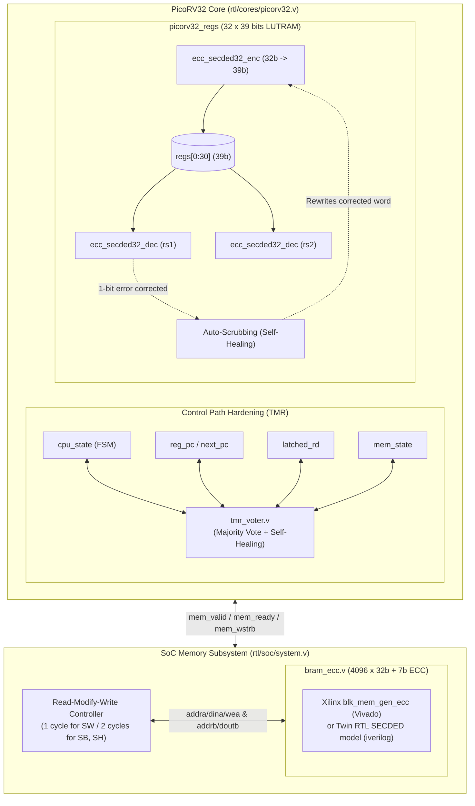

# PicoRV32 SoC for Nexys A7-100T

Minimal RISC-V (RV32I) System-on-Chip built around the [PicoRV32](https://github.com/YosysHQ/picorv32) core for the **Digilent Nexys A7-100T** (`xc7a100tcsg324-1`) FPGA board. Features a hybrid radiation-tolerant architecture combining selective **Triple Modular Redundancy (TMR)** for critical control logic and **SECDED ECC (Single Error Correction, Double Error Detection)** for memory structures (register file and 16 KB BRAM), along with a UART bootloader and memory-mapped peripherals.

## Architecture & Memory Map

The SoC (`rtl/soc/system.v`) runs at **100 MHz** and provides 16 KB of BRAM along with memory-mapped I/O:

| Address | Peripheral | Description |
| :--- | :--- | :--- |
| `0x0000_0000` | BRAM (16 KB) | Main memory initialized with `build/firmware.hex` / `firmware.coe` |
| `0x0000_0800` | `APP_BASE` | Entry point in RAM for applications loaded via UART |
| `0x1000_0000` | `REG_LEDS` | 15-bit user LEDs (`LED[14:0]`). `LED[15]` indicates `trap` |
| `0x2000_0004` | `REG_UART_CLKDIV` | UART baud rate divider (`868` for 115200 baud @ 100 MHz) |
| `0x2000_0008` | `REG_UART_DATA` | UART TX/RX data register (`simpleuart`) |

---

## Fault Tolerance Architecture

The design follows space-grade processor architecture principles (such as LEON3-FT and NOEL-V), applying targeted protection to each subsystem:



### 1. Selective TMR (Control Logic)
Activated with `PICORV32_TMR` (`TMR=1`). Critical control registers inside the core are triplicated (`_a`, `_b`, `_c` with `KEEP` / `DONT_TOUCH` attributes) and resolved through majority voters with self-healing feedback on every clock cycle:
- **Control FSM (`PICORV32_TMR_FSM`)**: Protects `cpu_state` against illegal state transitions.
- **Program Counter (`PICORV32_TMR_PC`)**: Protects `reg_pc` and `reg_next_pc`.
- **Control Path (`PICORV32_TMR_CTRL`)**: Protects the destination register index (`latched_rd`).
- **Memory Bus FSM (`PICORV32_TMR_MEM`)**: Protects `mem_state` during bus transactions.

### 2. SECDED ECC (Memories)
Activated with `PICORV32_ECC` (`ECC=1`). Implements $(39, 32)$ Single Error Correction, Double Error Detection using optimized XOR parity trees:
- **Core Register File (`picorv32_regs`)**:
  - Stored in distributed LUTRAM (`RAM32M`) expanded to 39 bits per entry.
  - Zero-cycle combinational decoding on both read ports (`rs1` and `rs2`).
  - **Auto-Scrubbing (Self-Healing)**: When a single-bit error is detected during read access and the CPU is not writing (`!wen`), the corrected 39-bit word is automatically written back on the next clock edge, preventing error accumulation.
- **Main 16 KB BRAM (`bram_ecc.v`)**:
  - Implements Simple Dual Port memory with 7 bits of parity per 32-bit word.
  - Generates the official Xilinx `blk_mem_gen` IP with Soft ECC in Vivado synthesis (`XILINX_ECC_IP`) and uses a fully compatible RTL twin model in Icarus Verilog / Verilator.
  - **Read-Modify-Write (RMW) Controller**: Handles partial byte writes (`sb`, `sh`) transparently in 2 cycles by reading the corrected 32-bit word, merging the modified bytes, and writing the complete word with recomputed parity. Full-word writes (`sw`) complete in 1 cycle.
  - Real-time fault injection and telemetry pins: `sbiterr`, `dbiterr`, `rdaddrecc`.

---

## Project Structure

```text
├── boards/nexys_a7_100T/   # Vivado XDC constraints and batch TCL scripts
├── prebuilt/               # Generated bitstreams (system*.bit)
├── reports/                # Vivado synthesis utilization and timing reports
├── rtl/
│   ├── common/
│   │   ├── ecc_secded32_dec.v # SECDED(39,32) decoder with error flags
│   │   ├── ecc_secded32_enc.v # SECDED(39,32) parity generator
│   │   └── tmr_voter.v        # Parameterizable majority voter + fault detector
│   ├── cores/picorv32.v       # PicoRV32 core (selective TMR + ECC register hook)
│   ├── periph/simpleuart.v    # UART peripheral
│   └── soc/
│       ├── bram_ecc.v         # BRAM wrapper (Xilinx IP in synth / SECDED model in sim)
│       └── system.v           # Top-level SoC integration with RMW controller
├── sim/
│   ├── ecc_secded32_tb.v      # Unit testbench for SECDED encoder/decoder
│   ├── picorv32_regs_tb.v     # Unit testbench for register file auto-scrubbing
│   └── system_tb.v            # System testbench with automated fault injection suite
└── sw/
    ├── apps/counter.c         # Sample LED counter + UART heartbeat app
    ├── bootloader/            # UART bootloader (self-test + binary loader to 0x800)
    └── common/                # Startup code, linker script, MMIO header, makehex tool
```

---

## Dependencies

- **RISC-V Toolchain**: `riscv64-unknown-elf-gcc`
- **Simulation & Linting**: `iverilog`, `vvp`, `verilator`, and optionally `surfer`
- **Synthesis & Flashing**: Xilinx `vivado` (batch mode) or `openFPGALoader`
- **Python 3**: `pyserial` (for `sw/common/upload.py`)

---

## Usage

### 1. Firmware & Bootloader

The base firmware loaded into BRAM at `0x0` is controlled by `FW_SRC` in the `Makefile`. Compiling the firmware generates both `build/firmware.hex` (for simulation) and `build/firmware.coe` (for Vivado BRAM IP initialization):

```bash
# Compile default base firmware (counter.c or bootloader.c)
make fw

# Or specify the source file explicitly
make fw FW_SRC=sw/bootloader/bootloader.c
```

To compile an application to be loaded into RAM (`0x800`) by the UART bootloader:

```bash
make app APP=counter
make upload APP=counter PORT=/dev/ttyUSB1
```

### 2. Simulation (Icarus Verilog)

```bash
# Standard RTL simulation (No hardening)
make sim

# TMR simulation with control path fault injection
make sim-tmr

# ECC simulation with memory fault injection (SEU, MEU, Auto-scrubbing)
make sim-ecc

# Full hardening simulation (TMR + ECC with 8 fault injection tests)
make sim-tmr-ecc

# Standalone unit tests for SECDED math & register auto-scrubbing
make sim-ecc-unit

# Run simulation and open waveforms in Surfer
make sim-waves
```

### 3. FPGA Synthesis & Programming (Vivado & openFPGALoader)

Vivado batch mode synthesizes the four hardening variants and outputs reports to `build/` and `reports/`:

```bash
# 1. Base (No hardening) -> prebuilt/system.bit
make synth
make prog         # Flash via Vivado JTAG
make prog-ofl     # Flash via openFPGALoader

# 2. TMR Only (Control path) -> prebuilt/system_tmr.bit
make synth-tmr
make prog-tmr
make prog-ofl-tmr

# 3. ECC Only (Memories) -> prebuilt/system_ecc.bit
make synth-ecc
make prog-ecc
make prog-ofl-ecc

# 4. Full Protection (TMR + ECC) -> prebuilt/system_tmr_ecc.bit
make synth-tmr-ecc
make prog-tmr-ecc
make prog-ofl-tmr-ecc
```

### 4. Code Quality & Linting

```bash
make lint    # Verilator linting on all RTL sources
make clean   # Clean build artifacts
```

---

## Synthesis & Resource Utilization Comparison

Target: **Xilinx Artix-7 XC7A100TCSG324-1** (Nexys A7-100T) @ **100 MHz** (`Period = 10.0 ns`).  
Synthesis reports extracted from Vivado batch implementation (`reports/`):

| Metric | Base (No Hardening) | TMR Only (Control Path) | ECC Only (Memories) | Full (TMR + ECC) |
| :--- | :---: | :---: | :---: | :---: |
| **Bitstream File** | `system.bit` (714 KB) | `system_tmr.bit` (818 KB) | `system_ecc.bit` (774 KB) | `system_tmr_ecc.bit` (865 KB) |
| **Slice LUTs** | **1,100** (1.74%) | **1,357** (+23.4%) | **1,595** (+45.0%) | **1,856** (+68.7%) |
| ↳ *LUT as Logic* | 1,056 | 1,313 | 1,511 | 1,772 |
| ↳ *LUT as Memory (LUTRAM)* | 44 | 44 | 84 (+90.9%) | 84 (+90.9%) |
| **Slice Registers (FFs)** | **703** (0.55%) | **870** (+23.8%) | **694** (-1.3%) | **861** (+22.5%) |
| **Distributed RAM (`RAM32M` Primitives)** | 10 `RAM32M` + 4 `RAM32X1D` | 10 `RAM32M` + 4 `RAM32X1D` | 20 `RAM32M` + 4 `RAM32X1D` | 20 `RAM32M` + 4 `RAM32X1D` |
| **Block RAM Tiles** | **4.0** (4 `RAMB36E1`) | **4.0** (4 `RAMB36E1`) | **4.5** (4 `RAMB36E1` + 1 `RAMB18E1`) | **4.5** (4 `RAMB36E1` + 1 `RAMB18E1`) |
| **Worst Negative Slack (WNS)** | **+3.056 ns** (MET) | **+2.426 ns** (MET) | **-1.011 ns** (VIOLATED) | **-0.547 ns** (VIOLATED) |
| **Worst Hold Slack (WHS)** | +0.151 ns | +0.127 ns | +0.155 ns | +0.118 ns |
| **Target Frequency ($F_{target}$)** | 100.0 MHz | 100.0 MHz | 100.0 MHz | 100.0 MHz |
| **Estimated Max Freq ($F_{max}$)** | **144.0 MHz** | **132.0 MHz** | **90.8 MHz** | **94.8 MHz** |

### Key Observations & Trade-Offs

1. **Low Silicon Footprint**:
   - Even with full TMR + ECC protection, the SoC consumes **< 3% of the total FPGA resources** on the Nexys A7-100T (1,856 of 63,400 LUTs, 861 of 126,800 FFs, and 4.5 of 135 BRAM tiles).
2. **Control Path Hardening (TMR)**:
   - Triplication of critical registers (`cpu_state`, `PC`, `latched_rd`, `mem_state`) and majority voters adds +257 LUTs (+23.4%) and +167 FFs (+23.8%).
   - Preserves high frequency margins ($F_{max} = 132.0$ MHz), easily meeting the 100 MHz system clock.
3. **Memory Hardening (ECC)**:
   - **Register File (`cpuregs`)**: Expanding entries from 32 to 39 bits doubles the required `RAM32M` primitives (from 10 to 20 primitives, 44 to 84 LUTs).
   - **Main 16 KB BRAM**: Adding 7 check bits across 4096 words allocates one additional `RAMB18E1` primitive (4.5 BRAM tiles total).
   - **Timing Impact of Soft ECC**: Because Xilinx Soft ECC inserts multi-level XOR parity trees in series with the memory read path, the critical path delay increases by ~2.5 ns. At speed grade -1, the maximum operating frequency with unpipelined Soft ECC is **~91-95 MHz** (or 100 MHz by enabling optional output pipeline registers in the BRAM controller).

---

## License

MIT
