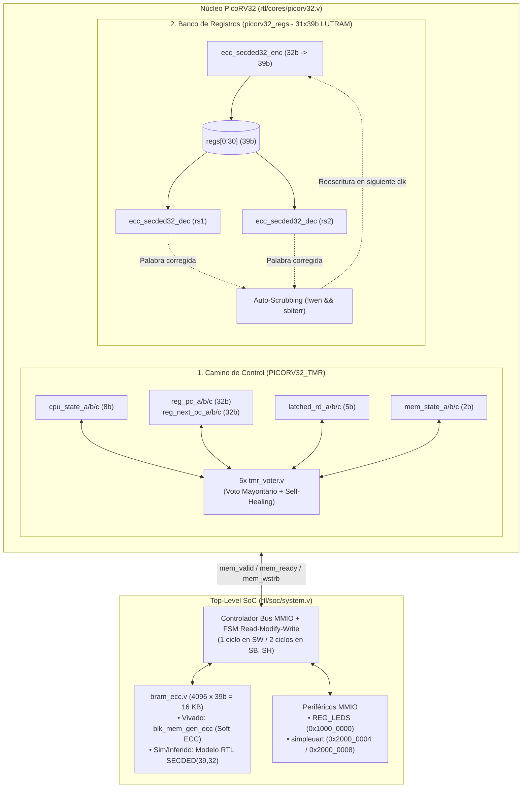

# Estado Actual y Evolución Histórica del Proyecto `picorv32-soc`

**Autor:** Julián Hinojosa Gil  
**Placa Objetivo:** Digilent Nexys A7-100T (`xc7a100tcsg324-1`, AMD/Xilinx Artix-7)  
**Último Commit (`HEAD`):** `8387328` (*Complete synthesis and resource utilization comparison in README.md from Vivado reports*)  
**Fecha de Actualización:** 11 de Noviembre de 2026

---

## 1. Resumen Ejecutivo y Estado Actual del Proyecto

El proyecto **`picorv32-soc`** implementa un *System-on-Chip (SoC)* minimalista basado en la arquitectura RISC-V (`RV32I`) a **100 MHz** alrededor del procesador [PicoRV32](file:///Users/julianhinojosagil/Documents/Dev/picorv32-soc/rtl/cores/picorv32.v), diseñado con una **arquitectura híbrida de tolerancia a fallos por radiación (SEU / MBU)** inspirada en procesadores espaciales como *LEON3-FT* y *NOEL-V*:

1. **Camino de Control Endurecido mediante TMR Selectivo (`PICORV32_TMR`)**: Triplicación física de los 4 registros secuenciales críticos del núcleo (`cpu_state`, `reg_pc`/`reg_next_pc`, `latched_rd` y `mem_state`) con votadores de mayoría ([`tmr_voter.v`](file:///Users/julianhinojosagil/Documents/Dev/picorv32-soc/rtl/common/tmr_voter.v)), detección instantánea de discrepancias y bucle de **autocuración (*self-healing feedback*)** ciclo a ciclo.
2. **Subsistema de Memoria Endurecido mediante SECDED ECC (`PICORV32_ECC`)**: Código de corrección de errores simples y detección de errores dobles **Hsiao $(39, 32)$** ([`ecc_secded32_enc.v`](file:///Users/julianhinojosagil/Documents/Dev/picorv32-soc/rtl/common/ecc_secded32_enc.v) y [`ecc_secded32_dec.v`](file:///Users/julianhinojosagil/Documents/Dev/picorv32-soc/rtl/common/ecc_secded32_dec.v)) aplicado a:
   - **Banco de registros (`picorv32_regs`)**: 31 registros de 39 bits sobre LUTRAM (`RAM32M`) con lectura combinacional en 0 ciclos y **auto-scrubbing oportunista** en 1 ciclo.
   - **Memoria principal BRAM de 16 KB ([`bram_ecc.v`](file:///Users/julianhinojosagil/Documents/Dev/picorv32-soc/rtl/soc/bram_ecc.v))**: Arquitectura dual (IP oficial `blk_mem_gen_ecc` de Xilinx con Soft ECC en síntesis Vivado y modelo gemelo RTL preinicializado en simulación `iverilog`) gobernada por un controlador **Read-Modify-Write (RMW)** en [`system.v`](file:///Users/julianhinojosagil/Documents/Dev/picorv32-soc/rtl/soc/system.v) que resuelve escrituras de palabra completa (`sw`) en 1 ciclo y escrituras parciales (`sb`, `sh`) en 2 ciclos.

---

### 1.1. Estado de las Fases e Hitos del Proyecto

| Etapa / Subsistema | Estado | Artefactos y Verificación |
| :--- | :---: | :--- |
| **1. SoC Base y Periféricos MMIO** | ✅ **100% Completado** | [`system.v`](file:///Users/julianhinojosagil/Documents/Dev/picorv32-soc/rtl/soc/system.v), [`simpleuart.v`](file:///Users/julianhinojosagil/Documents/Dev/picorv32-soc/rtl/periph/simpleuart.v), [`nexys_a7.xdc`](file:///Users/julianhinojosagil/Documents/Dev/picorv32-soc/boards/nexys_a7_100T/nexys_a7.xdc) |
| **2. Ecosistema Software y Bootloader UART** | ✅ **100% Completado** | [`bootloader.c`](file:///Users/julianhinojosagil/Documents/Dev/picorv32-soc/sw/bootloader/bootloader.c), [`counter.c`](file:///Users/julianhinojosagil/Documents/Dev/picorv32-soc/sw/apps/counter.c), [`upload.py`](file:///Users/julianhinojosagil/Documents/Dev/picorv32-soc/sw/common/upload.py), [`makehex.py`](file:///Users/julianhinojosagil/Documents/Dev/picorv32-soc/sw/common/makehex.py) |
| **3. Flujo Open-Source (Simulación y Linting)** | ✅ **100% Completado** | `iverilog`, `vvp`, `verilator` (`make lint`), `verible`, `openFPGALoader` |
| **4. Endurecimiento TMR Selectivo (Control)** | ✅ **100% Completado** | [`tmr_voter.v`](file:///Users/julianhinojosagil/Documents/Dev/picorv32-soc/rtl/common/tmr_voter.v), 4 dominios TMR en [`picorv32.v`](file:///Users/julianhinojosagil/Documents/Dev/picorv32-soc/rtl/cores/picorv32.v), 4 tests SEU en [`system_tb.v`](file:///Users/julianhinojosagil/Documents/Dev/picorv32-soc/sim/system_tb.v) |
| **5. Endurecimiento ECC SECDED (Memorias)** | ✅ **100% Completado** | [`ecc_secded32_enc.v`](file:///Users/julianhinojosagil/Documents/Dev/picorv32-soc/rtl/common/ecc_secded32_enc.v), [`ecc_secded32_dec.v`](file:///Users/julianhinojosagil/Documents/Dev/picorv32-soc/rtl/common/ecc_secded32_dec.v), [`bram_ecc.v`](file:///Users/julianhinojosagil/Documents/Dev/picorv32-soc/rtl/soc/bram_ecc.v), RMW en [`system.v`](file:///Users/julianhinojosagil/Documents/Dev/picorv32-soc/rtl/soc/system.v) |
| **6. Verificación por Inyección de Fallos** | ✅ **100% Completado** | [`ecc_secded32_tb.v`](file:///Users/julianhinojosagil/Documents/Dev/picorv32-soc/sim/ecc_secded32_tb.v) (39 SEU + 741 MEU), [`picorv32_regs_tb.v`](file:///Users/julianhinojosagil/Documents/Dev/picorv32-soc/sim/picorv32_regs_tb.v), [`system_tb.v`](file:///Users/julianhinojosagil/Documents/Dev/picorv32-soc/sim/system_tb.v) (8 tests) |
| **7. Síntesis Vivado (4 Variantes) y Reportes** | ✅ **100% Completado** | 4 bitstreams en `prebuilt/` y 8 informes detallados en `reports/` |
| **8. Estudio PG058 y Portabilidad a PolarFire** | ✅ **100% Completado** | Documentado en [`docs/estudio_ecc_vivado_polarfire.md`](file:///Users/julianhinojosagil/Documents/Dev/picorv32-soc/docs/estudio_ecc_vivado_polarfire.md) |
| **9. Inicialización de BRAM con IP ECC en Placa** | 🔄 **Pendiente / Siguiente Fase** | El IP `blk_mem_gen_ecc` de Vivado no admite `.coe` con ECC activo; requiere Boot ROM o carga inicial antes de liberar reset |

---

### 1.2. Estado Actual del Árbol de Trabajo Git (`git status`)

- **Rama activa**: `main` (sincronizada con `origin/main` en el commit `8387328`).
- **Cambios locales no confirmados (*unstaged*)**:
  1. [`rtl/common/tmr_voter.v`](file:///Users/julianhinojosagil/Documents/Dev/picorv32-soc/rtl/common/tmr_voter.v): Adición de 3 comentarios explicativos en inglés sobre la lógica de votación por mayoría y la detección de fallos mediante XOR.
  2. Directorio [`docs/`](file:///Users/julianhinojosagil/Documents/Dev/picorv32-soc/docs/) (*untracked*): Contiene el informe [`docs/estudio_ecc_vivado_polarfire.md`](file:///Users/julianhinojosagil/Documents/Dev/picorv32-soc/docs/estudio_ecc_vivado_polarfire.md) y el presente documento de estado y evolución.

---

### 1.3. Resultados Consolidados de Síntesis Física y Temporización (Vivado)

Datos extraídos de los informes oficiales en [`reports/`](file:///Users/julianhinojosagil/Documents/Dev/picorv32-soc/reports) para la FPGA **Xilinx Artix-7 XC7A100TCSG324-1** con reloj objetivo de **100.0 MHz** ($T = 10.000\text{ ns}$):

| Métrica | 1. Base (`system`) | 2. Solo TMR (`system_tmr`) | 3. Solo ECC (`system_ecc`) | 4. Completo (`system_tmr_ecc`) |
| :--- | :---: | :---: | :---: | :---: |
| **Fichero Bitstream (`prebuilt/`)** | `system.bit` (714 KB) | `system_tmr.bit` (818 KB) | `system_ecc.bit` (774 KB) | `system_tmr_ecc.bit` (865 KB) |
| **Slice LUTs Totales** | **1,100** (1.74%) | **1,357** (+23.4%) | **1,595** (+45.0%) | **1,856** (+68.7%) |
| ↳ *LUT como Lógica* | 1,056 | 1,313 | 1,511 | 1,772 |
| ↳ *LUT como Memoria (LUTRAM)* | 44 | 44 | 84 (+90.9%) | 84 (+90.9%) |
| **Slice Registers (Flip-Flops)** | **703** (0.55%) | **870** (+23.8%) | **694** (-1.3%) | **861** (+22.5%) |
| **Primitivas LUTRAM (`RAM32M`)** | 10 `RAM32M` + 4 `RAM32X1D` | 10 `RAM32M` + 4 `RAM32X1D` | 20 `RAM32M` + 4 `RAM32X1D` | 20 `RAM32M` + 4 `RAM32X1D` |
| **Block RAM Tiles** | **4.0** (4 `RAMB36E1`) | **4.0** (4 `RAMB36E1`) | **4.5** (4 `RAMB36E1` + 1 `RAMB18E1`) | **4.5** (4 `RAMB36E1` + 1 `RAMB18E1`) |
| **Worst Negative Slack (WNS)** | **+3.056 ns** (MET) | **+2.426 ns** (MET) | **-1.011 ns** (VIOLATED) | **-0.547 ns** (VIOLATED) |
| **Worst Hold Slack (WHS)** | +0.151 ns | +0.127 ns | +0.155 ns | +0.118 ns |
| **Niveles Lógicos (Ruta Crítica)** | 5 | 5 | 12 (`1 RAMD32 + 11 LUTs`) | 11 (`1 RAMD32 + 10 LUTs`) |
| **Frecuencia Máxima Estimada ($F_{\max}$)** | **144.0 MHz** | **132.0 MHz** | **90.8 MHz** | **94.8 MHz** |

---

## 2. Repaso Cronológico de Todas las Conversaciones

A lo largo del desarrollo del proyecto hemos mantenido **21 sesiones de trabajo** organizadas en 6 etapas claramente diferenciadas:

### Etapa A: Estudio Teórico del Core PicoRV32 y Puesta en Marcha del SoC Base (27 – 28 Oct)

1. **[Estudio integral de la arquitectura PicoRV32](conversation://2199d0ce-a805-4ccb-a8e3-b173fb181602)** *(27–28 Oct, 11 mensajes)*:
   - Analizamos a fondo el diseño interno de [`picorv32.v`](file:///Users/julianhinojosagil/Documents/Dev/picorv32-soc/rtl/cores/picorv32.v): su naturaleza multiciclo (máquina de estados `cpu_state` de 8 estados *one-hot* sin pipeline clásico de 5 etapas), su área mínima (~750–2000 LUTs), sus parámetros de configuración, la interfaz nativa de memoria (`mem_valid`, `mem_ready`, `mem_addr`, `mem_wdata`, `mem_wstrb`, `mem_rdata`) y la interfaz *Look-Ahead (`mem_la_*`)*.
   - Estudiamos la interfaz de coprocesador **PCPI (*Pico Co-Processor Interface*)** para instrucciones `RV32M` (`MUL`/`DIV`), el sistema personalizado de interrupciones (`getq`, `setq`, `retirq`, `maskirq`, `waitirq`, `timer` codificados mediante directivas `.insn` en ensamblador), los wrappers `picorv32_axi` y `picorv32_wb`, y el proceso de compilación cruzada de firmware (`firmware.S`, `firmware.lds`, `makehex.py`) comparándolo con la experiencia previa en el SoC *HaDes-V*.

2. **[Creación del repositorio `picorv32-soc`, Fase 0 y primera síntesis en Nexys A7-100T](conversation://a88b810c-5e20-4a57-947f-6cd651275a44)** *(28 Oct, 16 mensajes)*:
   - Definimos la estructura limpia del repositorio (`rtl/cores`, `rtl/periph`, `rtl/soc`, `sim`, `sw/common`, `boards/nexys_a7_100T`) partiendo de los ficheros base del repositorio oficial de PicoRV32.
   - Adaptamos [`system.v`](file:///Users/julianhinojosagil/Documents/Dev/picorv32-soc/rtl/soc/system.v) para la placa **Digilent Nexys A7-100T** (reloj de 100 MHz en pin `E3`, botón `CPU_RESETN` activo a nivel bajo en `C12`, 15 LEDs de usuario `LED[14:0]`, `LED[15]` para `trap`, y periférico `simpleuart` conectado a los pines FTDI `D4`/`C4`).
   - Depuramos la compilación con `riscv64-unknown-elf-gcc`, la simulación con `xvlog`/`xelab`/`xsim`, la síntesis en modo *batch* con Vivado ([`synth_system.tcl`](file:///Users/julianhinojosagil/Documents/Dev/picorv32-soc/boards/nexys_a7_100T/synth_system.tcl)) y el flasheo por JTAG ([`prog.tcl`](file:///Users/julianhinojosagil/Documents/Dev/picorv32-soc/boards/nexys_a7_100T/prog.tcl)).

---

### Etapa B: Entorno de Desarrollo, Bootloader UART y Depuración Hardware en Placa (28 Oct – 2 Nov)

3. **[Configuración de VSCode, Verilator y Verible en Linux/macOS](conversation://1dd65189-793a-4dff-85ab-618d4b7da029)** *(28–31 Oct, 14 mensajes)*:
   - Configuramos las extensiones de VSCode (*Verilog-HDL/SystemVerilog* y *Verible*), el linter **Verilator** (`-sv --lint-only -Wall`) y el archivo [`verible.filelist`](file:///Users/julianhinojosagil/Documents/Dev/picorv32-soc/verible.filelist).
   - Analizamos y silenciamos los falsos positivos de linting en el código original de `picorv32.v` (como asignaciones bloqueantes en circuitos secuenciales o macros `PICORV32_REGS`), logrando un flujo `make lint` sin errores.

4. **[Diseño del Bootloader UART, aplicaciones en RAM y caza del bug de recepción serie en placa](conversation://b5b037e1-32eb-45fa-bdd3-129b157fca85)** *(29 Oct, 25 mensajes)*:
   - Estudiamos en detalle el mapa de memoria MMIO (`0x1000_0000` para LEDs, `0x2000_0004` para divisor de baudios `868` = $100\text{ MHz} / 115200$, `0x2000_0008` para datos UART) y el script de enlazado [`firmware.lds`](file:///Users/julianhinojosagil/Documents/Dev/picorv32-soc/sw/common/firmware.lds).
   - Diseñamos una arquitectura de memoria dividida: el **bootloader** ([`sw/bootloader/bootloader.c`](file:///Users/julianhinojosagil/Documents/Dev/picorv32-soc/sw/bootloader/bootloader.c)) reside en `0x0000_0000`, ejecuta un `self_test()` de LEDs y RAM, envía `"READY\n"` por UART, recibe 4 bytes con el tamaño del binario seguidos del payload y salta a `APP_BASE = 0x0000_0800` (2 KB), donde se enlazan las aplicaciones como [`counter.c`](file:///Users/julianhinojosagil/Documents/Dev/picorv32-soc/sw/apps/counter.c).
   - **Resolución de 2 bugs críticos al probar en la placa física**:
     1. *Bug del Linker (`firmware.lds`)*: Al usar `. = ORG;` dentro de la sección `.text`, `objcopy` rellenaba con 2048 ceros desde `0x0000` hasta `0x0800`, haciendo que `counter.bin` pesara 2.6 KB y desplazara el punto de entrada a `0x1000`. Se corrigió fijando el origen de la región `MEM` a `ORIGIN = ORG` en [`firmware.lds`](file:///Users/julianhinojosagil/Documents/Dev/picorv32-soc/sw/common/firmware.lds#L3).
     2. *Bug de Hardware en `simpleuart` y `system.v` (LEDs congelados en `0x5555`)*: Al enviar el tamaño por UART (ej. `596` bytes = `0x00000254`), los dos últimos bytes eran `0x00`. En [`sw/common/io.h`](file:///Users/julianhinojosagil/Documents/Dev/picorv32-soc/sw/common/io.h), `uart_getc()` hacía `while ((c = REG_UART_DATA) == -1);` pero también descartaba el byte `0x00` o sufría una doble lectura porque en [`system.v`](file:///Users/julianhinojosagil/Documents/Dev/picorv32-soc/rtl/soc/system.v#L153) la señal `reg_dat_re` duraba **2 ciclos de reloj** (mientras `mem_ready` se registraba), provocando que `simpleuart` limpiara el byte recibido en el ciclo 1 y entregara `0xFFFF_FFFF` (`-1`) en el ciclo 2 cuando la CPU capturaba `mem_rdata`. Se solucionó calificando `.reg_dat_re(uart_dat_sel && !mem_wstrb && !mem_ready)` en [`system.v`](file:///Users/julianhinojosagil/Documents/Dev/picorv32-soc/rtl/soc/system.v#L153).

5. **[Consulta sobre bootloaders existentes para PicoRV32](conversation://83a730c5-915d-475c-8b9b-293489a58283)** *(29 Oct, 1 mensaje)*:
   - Revisamos cómo manejan la carga de programas otros proyectos basados en PicoRV32 (*picosoc* con SPI Flash XIP, *litex*, etc.) frente a nuestro bootloader UART en BRAM.

6. **[Funcionamiento interno del controlador MMIO y acceso por bytes a la BRAM en `system.v`](conversation://ba5ae1a7-0962-432d-9997-5b32b7f00d5d)** *(29 Oct, 3 mensajes)*:
   - Explicación paso a paso del decodificador de direcciones en [`system.v`](file:///Users/julianhinojosagil/Documents/Dev/picorv32-soc/rtl/soc/system.v), el direccionamiento por palabra (`mem_addr >> 2` / `mem_addr[15:2]`) y el uso de las 4 máscaras de escritura `mem_wstrb[3:0]` para escribir bytes individuales en una palabra de 32 bits.

7. **[Documentación en código del fix de `reg_dat_re` en `system.v`](conversation://cf59e02c-8594-4a48-9436-426eba402da1)** *(29 Oct, 1 mensaje)*:
   - Redactamos un comentario técnico claro en [`rtl/soc/system.v`](file:///Users/julianhinojosagil/Documents/Dev/picorv32-soc/rtl/soc/system.v#L150-L153) explicando por qué `reg_dat_re` debe calificarse con `!mem_ready`.

8. **[Gestión de la Pila (Stack Pointer `sp`), reinicio y convivencia Bootloader + App en RAM](conversation://85c1cda8-8a64-4855-91da-27abd4c39a56)** *(2 Nov, 3 mensajes)*:
   - Analizamos cómo crece la pila hacia abajo desde el final de los 16 KB de BRAM (`0x0000_4000` hacia direcciones menores) mientras el código `.text`/`.data` se ubica al principio (`0x0000_0000` para el bootloader y `0x0000_0800` para la aplicación), y cómo [`sw/common/firmware.S`](file:///Users/julianhinojosagil/Documents/Dev/picorv32-soc/sw/common/firmware.S) reinicializa `sp = 0x4000` tanto al arrancar en `0x0` como al saltar a `0x800`.

---

### Etapa C: Exploración de Benchmarks, IPs de Vivado e Interfaz Look-Ahead (2 Nov)

9. **[Sistemas de carga de programas en el repositorio original de PicoRV32](conversation://fd85a6d7-de34-476a-8d53-e2a1cf75f09b)** *(2 Nov, 1 mensaje)*:
   - Comparamos el arnés de pruebas del repositorio original de Claire Wolf (que usa `$readmemh` directo en simulación o SPI Flash en *picosoc*) con nuestro flujo en FPGA real.

10. **[Evaluación del benchmark Dhrystone para el SoC](conversation://ba0c1258-a58a-4495-bda5-d22ba65d9f62)** *(2 Nov, 1 mensaje)*:
    - Evaluamos la viabilidad de usar *Dhrystone* como carga de trabajo frente a aplicaciones ligeras como `counter.c` (teniendo en cuenta que Dhrystone requiere más de 16 KB de RAM si se enlaza con `newlib` estándar, mientras que `counter.c` ocupa < 1 KB y permite simular miles de iteraciones e inyectar fallos en pocos milisegundos).

11. **[Estrategias para integrar y probar IPs de Vivado sin romper el flujo en modo batch](conversation://688b692d-77e6-44a4-bf1d-e7b4410540c8)** *(2 Nov, 2 mensajes)*:
    - Definimos la estrategia para instanciar IPs de Xilinx mediante comandos TCL (`create_ip`, `set_property`, `generate_target`, `synth_ip`) dentro de [`synth_system.tcl`](file:///Users/julianhinojosagil/Documents/Dev/picorv32-soc/boards/nexys_a7_100T/synth_system.tcl) sin depender de proyectos `.xpr` pesados en Git.

12. **[Análisis de la interfaz Look-Ahead (`mem_la_*`) de PicoRV32](conversation://62404f8d-e501-45db-aa94-aff0c810daa9)** *(2 Nov, 2 mensajes)*:
    - Analizamos las señales `mem_la_read`, `mem_la_write`, `mem_la_addr`, `mem_la_wdata` y `mem_la_wstrb` de [`picorv32.v`](file:///Users/julianhinojosagil/Documents/Dev/picorv32-soc/rtl/cores/picorv32.v), que adelantan la transacción de memoria 1 ciclo antes que `mem_valid`, y por qué nuestra interfaz estándar con `mem_valid` es más limpia y segura para el controlador RMW con ECC.

13. **[Empaquetado de PicoRV32 como IP en Vivado y limpieza de warnings](conversation://b43d4a6e-67c3-4f5e-a5c5-14f7f8d39b3b)** *(2 Nov, 1 mensaje)* y **[Creación de un Block Design en Vivado IP Integrator](conversation://61dbbca8-0ae2-407e-aa94-557ee936b0a6)** *(2 Nov, 11 mensajes)*:
    - Probamos de forma experimental cómo empaquetar PicoRV32 como IP en el GUI de Vivado (*Block Design*) con `Clocking Wizard`, `Processor System Reset` y `AXI interconnect`, comparando la complejidad de un diseño basado en bloques AXI frente a la ligereza y control total de nuestro SoC en RTL puro ([`system.v`](file:///Users/julianhinojosagil/Documents/Dev/picorv32-soc/rtl/soc/system.v)).

---

### Etapa D: Diseño, Implementación y Verificación del Endurecimiento TMR Selectivo (7 – 8 Nov)

14. **[Diseño e implementación completa del TMR Selectivo en `picorv32.v` y `tmr_voter.v`](conversation://dabefd92-86ac-4499-986a-6b2040c80bd7)** *(7–8 Nov, 23 mensajes)*:
    - Comparamos **TMR de Grano Grueso** (triplicar todo el core) frente a **TMR Selectivo de Grano Fino** en el camino de control combinado con ECC en memorias.
    - Identificamos los registros de control con mayor *Architectural Vulnerability Factor (AVF)* en [`picorv32.v`](file:///Users/julianhinojosagil/Documents/Dev/picorv32-soc/rtl/cores/picorv32.v):
      1. `cpu_state` (8 bits, FSM principal *one-hot* — `PICORV32_TMR_FSM`).
      2. `reg_pc` y `reg_next_pc` ($2 \times 32$ bits, Contador de Programa — `PICORV32_TMR_PC`).
      3. `latched_rd` (5 bits, índice del registro destino — `PICORV32_TMR_CTRL`).
      4. `mem_state` (2 bits, FSM del controlador de bus — `PICORV32_TMR_MEM`).
    - Creamos el módulo parametrizable [`rtl/common/tmr_voter.v`](file:///Users/julianhinojosagil/Documents/Dev/picorv32-soc/rtl/common/tmr_voter.v) con lógica de mayoría libre de riesgos estáticos y salida `fault_detected`.
    - Añadimos atributos `(* keep = "true", syn_keep = "true" *)` a los registros `_a`, `_b`, `_c`, implementamos las macros de escritura triplicada (`SET_CPU_STATE`, `SET_REG_PC`, `SET_LAT_RD`, `OR_LAT_RD`, `SET_MEM_STATE`) y el bucle de **Autocuración (*Self-Healing*)** al inicio del bloque `always @(posedge clk)`.
    - Desarrollamos los 4 tests de inyección de fallos SEU mediante `force`/`release` en [`sim/system_tb.v`](file:///Users/julianhinojosagil/Documents/Dev/picorv32-soc/sim/system_tb.v#L55-L212).

---

### Etapa E: Plan Maestro e Implementación en 5 Fases del Subsistema de Memoria con ECC SECDED (8 – 9 Nov)

15. **[Estudio de opciones y elaboración del Plan Maestro de ECC en Memorias](conversation://01523705-b1d8-491c-bae5-af73dac1ff59)** *(8 Nov, 9 mensajes — Artefacto: `ecc_implementation_plan.md`)*:
    - Analizamos las alternativas para proteger las dos memorias del SoC:
      - Para el **Banco de Registros (`cpuregs`)**: descartamos usar BRAM IP (porque añadiría 1 ciclo de latencia rompiendo el estado `ld_rs1` de PicoRV32 y desperdiciaría >96% de 2 bloques BRAM) y descartamos el IP de LUTRAM de Xilinx (porque no soporta ECC). Elegimos implementar **SECDED $(39,32)$ en RTL sobre `picorv32_regs` (LUTRAM `RAM32M`) con lectura en 0 ciclos y *Auto-Scrubbing***.
      - Para la **BRAM de 16 KB**: elegimos usar un wrapper [`bram_ecc.v`](file:///Users/julianhinojosagil/Documents/Dev/picorv32-soc/rtl/soc/bram_ecc.v) que instancia el IP **Block Memory Generator (`blk_mem_gen_ecc`)** de Xilinx en síntesis Vivado y un modelo gemelo RTL en simulación `iverilog`, acompañado de un controlador **Read-Modify-Write (RMW)** en [`system.v`](file:///Users/julianhinojosagil/Documents/Dev/picorv32-soc/rtl/soc/system.v) para soportar instrucciones `sb` y `sh`.
    - Estructuramos el desarrollo en un plan de **5 Fases**.

16. **[Fase 1 del Plan ECC: Motor matemático SECDED(39,32) de Hsiao y testbench exhaustivo](conversation://dc88fd35-3cab-49d7-b1be-8031afda6ef7)** *(8 Nov, 10 mensajes)*:
    - El usuario escribió paso a paso en Verilog los módulos [`rtl/common/ecc_secded32_enc.v`](file:///Users/julianhinojosagil/Documents/Dev/picorv32-soc/rtl/common/ecc_secded32_enc.v) y [`rtl/common/ecc_secded32_dec.v`](file:///Users/julianhinojosagil/Documents/Dev/picorv32-soc/rtl/common/ecc_secded32_dec.v) utilizando una matriz de paridad de **Hsiao de peso 3 constante**, donde cada bit de paridad es el XOR de 13 o 14 bits de datos, `sbiterr = ^syndrome` y `dbiterr = (syndrome != 7'b0) & ~sbiterr`.
    - Desarrollamos [`sim/ecc_secded32_tb.v`](file:///Users/julianhinojosagil/Documents/Dev/picorv32-soc/sim/ecc_secded32_tb.v), verificando con éxito el 100% de los **39 errores simples posibles (SEU)** y las **$\binom{39}{2} = 741$ combinaciones de errores dobles posibles (MEU)**.

17. **[Fase 2 del Plan ECC: Banco de registros `picorv32_regs` con SECDED y Auto-Scrubbing](conversation://aa3c087f-9225-43d9-9c7a-c2188036d32d)** *(8 Nov, 7 mensajes)*:
    - Expandimos [`picorv32_regs`](file:///Users/julianhinojosagil/Documents/Dev/picorv32-soc/rtl/cores/picorv32.v#L2384-L2495) de 32 a 39 bits (`reg [38:0] regs [0:30]`), conectamos dos decodificadores combinacionales (`dec1` y `dec2`) en los puertos `raddr1`/`raddr2`, añadimos la guarda para el registro `x0` y construimos el bucle de **auto-scrubbing** que reescribe la palabra corregida cuando `!wen && (sbiterr1 || sbiterr2)` e inhibe la escritura si ocurre un error doble (`dbiterr`).
    - Creamos el testbench unitario [`sim/picorv32_regs_tb.v`](file:///Users/julianhinojosagil/Documents/Dev/picorv32-soc/sim/picorv32_regs_tb.v) y el target `make sim-ecc-unit`.

18. **[Fase 3 del Plan ECC: Wrapper `bram_ecc.v`, controlador RMW en `system.v` y generador `.coe`](conversation://6834d6a4-9371-4db3-8761-a8652c3b9b54)** *(8 Nov, 20 mensajes)*:
    - Implementamos [`rtl/soc/bram_ecc.v`](file:///Users/julianhinojosagil/Documents/Dev/picorv32-soc/rtl/soc/bram_ecc.v) con soporte dual (`XILINX_ECC_IP` para Vivado y modelo RTL con función `calc_ecc_parity()` para inicializar `mem[0:4095]` con los 32 bits de `firmware.hex` más sus 7 bits de paridad Hsiao).
    - Integramos en [`rtl/soc/system.v`](file:///Users/julianhinojosagil/Documents/Dev/picorv32-soc/rtl/soc/system.v#L73-L123) la máquina de estados `rmw_state` y el multiplexor `rmw_merged_data` para ejecutar `sw` en 1 ciclo y `sb`/`sh` en 2 ciclos.
    - Actualizamos [`sw/common/makehex.py`](file:///Users/julianhinojosagil/Documents/Dev/picorv32-soc/sw/common/makehex.py) para generar simultáneamente `build/firmware.hex` y `build/firmware.coe`.

19. **[Fase 4 del Plan ECC: Suite de inyección de fallos SEU/MEU en `system_tb.v`](conversation://882abf6d-72df-4d1d-bdf5-37073f6979df)** *(8–9 Nov, 11 mensajes)*:
    - Añadimos los 4 tests de inyección de fallos de memoria en [`sim/system_tb.v`](file:///Users/julianhinojosagil/Documents/Dev/picorv32-soc/sim/system_tb.v#L280-L526):
      - Test 5 (`95,000` ciclos): SEU de 1 bit en el registro activo `x15` (`a5`) y verificación de curación por *auto-scrubbing* en el ciclo siguiente.
      - Test 6 (`110,000` ciclos): MEU de 2 bits en `x15`, verificación de `regfile_dbiterr = 1` e inhibición del *auto-scrubbing*.
      - Test 7 (`125,000` ciclos): SEU de 1 bit en la dirección `0x020` (`mem[8]`) de la BRAM durante el *instruction fetch* de `puts()`, verificando corrección al vuelo sin `trap` y reporte en `bram_rdaddrecc == 8`.
      - Test 8 (`140,000` ciclos): MEU de 2 bits en `mem[8]` de la BRAM, verificando `bram_dbiterr = 1` y `bram_rdaddrecc == 8`.

20. **[Fase 5 del Plan ECC: Automatización en Vivado (`synth_system.tcl`), descubrimiento de restricciones PG058 y cierre de reportes](conversation://98f75b95-7d43-472c-9b43-c54b49d04ca7)** *(8–9 Nov, 12 mensajes — Artefacto: `ecc_final_report.md`)*:
    - Automatizamos la síntesis de las 4 variantes (`synth`, `synth-tmr`, `synth-ecc`, `synth-tmr-ecc`) en [`boards/nexys_a7_100T/synth_system.tcl`](file:///Users/julianhinojosagil/Documents/Dev/picorv32-soc/boards/nexys_a7_100T/synth_system.tcl) y [`Makefile`](file:///Users/julianhinojosagil/Documents/Dev/picorv32-soc/Makefile).
    - Al ejecutar Vivado en la estación de trabajo Linux, descubrimos empíricamente las dos restricciones del IP `blk_mem_gen` v8.4 (PG058) en Artix-7:
      1. El ECC nativo (*Hard ECC*) solo admite anchos de 64 bits; para 32 bits es obligatorio usar `CONFIG.softecc {true}`.
      2. Vivado prohíbe usar `CONFIG.Load_Init_File {true}` (`.coe`) cuando `softecc` está habilitado.
    - Probamos primero la síntesis con BRAM inferida inicializada (commit `ee3b8d2`) y, dado el requisito del grupo de investigación de evaluar la IP verificada de Xilinx, configuramos `synth_system.tcl` para generar la IP oficial `blk_mem_gen_ecc` sin inicializar (`CONFIG.Load_Init_File {false}`, commit `3214bcc`), extrajimos los 8 reportes de utilización y timing en `reports/` y completamos la comparativa en [`README.md`](file:///Users/julianhinojosagil/Documents/Dev/picorv32-soc/README.md).

---

### Etapa F: Documentación de Defensa, Pruebas en Placa y Cierre de Tarea de Investigación (9 – 11 Nov)

21. **[Generación del Reporte Técnico Final de Defensa (TMR + ECC)](conversation://4938ad3f-41b5-4294-bdb9-22bd463dc936)** *(9 Nov, 2 mensajes — Artefacto: `reporte_final_tmr_ecc.md`)*:
    - Elaboramos un documento técnico profundo explicando toda la arquitectura, la matemática del código de Hsiao, el *self-healing*, el controlador RMW, las decisiones tomadas frente a las descartadas y el desglose del camino crítico de 11–12 niveles lógicos en Vivado.

22. **[Pruebas en placa desde macOS (`openFPGALoader`) y diagnóstico del `LED[15]` (`trap`) en `system_tmr_ecc.bit`](conversation://7cdba806-c9b9-4e7a-bc40-127df5432b1d)** *(9 Nov, 3 mensajes)* y **[Análisis del salto a `trap` en la dirección `0x0000_0000`](conversation://e6747c28-333b-4501-9c0a-af21ab568d99)** *(9 Nov, 1 mensaje)*:
    - Se verificó en la placa Nexys A7-100T que `make prog-ofl-tmr` (`prebuilt/system_tmr.bit`) ejecuta perfectamente el programa `counter.c`.
    - Al flashear `make prog-ofl-tmr-ecc` (`prebuilt/system_tmr_ecc.bit`), se encendió inmediatamente el **LED 15 (`trap`)**. Diagnosticamos la causa exacta: no se debe a la frecuencia de reloj (94.8 MHz vs 100 MHz), sino a que `system_tmr_ecc.bit` se sintetizó con la IP `blk_mem_gen_ecc` de Xilinx con `Load_Init_File {false}` (memoria llena de ceros `0x0000_0000`). En RISC-V, la palabra `0x0000_0000` es una instrucción ilegal (todos los opcodes válidos tienen los bits `[1:0] == 2'b11`), por lo que en el primer *fetch* en `PC = 0x0000_0000` con `CATCH_ILLINSN = 1`, PicoRV32 salta a `cpu_state_trap` y enciende `LED[15]`.

23. **[Justificación de por qué no se usa la IP de Xilinx en el banco de registros](conversation://5bab34e4-3834-445f-bb96-f1bf7388e085)** *(9 Nov, 1 mensaje)*:
    - Repasamos por qué el banco de registros utiliza nuestra implementación RTL sobre LUTRAM (`RAM32M`) en lugar de la IP `blk_mem_gen`: lectura asíncrona en 0 ciclos requerida por `cpu_state_ld_rs1`, doble puerto de lectura simultáneo (`rs1` y `rs2`), ahorro de bloques BRAM y capacidad de *auto-scrubbing* en 1 ciclo.

24. **[Verificación y cierre de la tarea de investigación *INV: Estudio y caracterización de ECC en Vivado y PolarFire*](conversation://221a5eef-cf31-4983-a187-718a492b4615)** *(11 Nov, 1 mensaje)*:
    - Revisamos el checklist completo de la tarea de investigación y generamos el documento técnico [`docs/estudio_ecc_vivado_polarfire.md`](file:///Users/julianhinojosagil/Documents/Dev/picorv32-soc/docs/estudio_ecc_vivado_polarfire.md), incluyendo la comparativa con la arquitectura **Microchip PolarFire** (bloques LSRAM con soporte Hard ECC nativo para 32 bits sin coste en LUTs e inmunidad SEU en configuración Flash SONOS).

---

## 3. Historial Completo de Commits de Git (45 Commits)

A continuación se detalla la trazabilidad completa de los **45 commits** registrados en el repositorio desde su creación hasta `HEAD`:

### 3.1. Fase Inicial: Creación del Repositorio y Adaptación Base (28 – 29 Oct 2026)
| Commit | Fecha | Descripción y Cambios Realizados |
| :--- | :---: | :--- |
| `8f72c21` | 2026-10-28 | **Initial commit**: Creación del repositorio con licencia MIT ([`LICENSE`](file:///Users/julianhinojosagil/Documents/Dev/picorv32-soc/LICENSE)). |
| `73bbcc0` | 2026-10-28 | **Base files from picorv32 repo**: Importación inicial de `picorv32.v`, `simpleuart.v`, `system.v`, `system_tb.v`, `firmware.S`, `firmware.c`, `firmware.lds`, `makehex.py` y scripts base de síntesis. |
| `a9ffed2` | 2026-10-29 | **Minimal mods**: Primeras adaptaciones del `Makefile`, restricciones XDC para Nexys A7-100T, script `prog.tcl` de programación por JTAG y ajustes en `system_tb.v` y `firmware.c`. |

### 3.2. Desarrollo del Bootloader UART, Aplicaciones y Corrección de Bugs de Bus (29 Oct – 2 Nov 2026)
| Commit | Fecha | Descripción y Cambios Realizados |
| :--- | :---: | :--- |
| `41bfe07` | 2026-10-29 | **little fixes + small bootloader**: Renombrado de `synth_area.xdc` a [`nexys_a7.xdc`](file:///Users/julianhinojosagil/Documents/Dev/picorv32-soc/boards/nexys_a7_100T/nexys_a7.xdc), rediseño de [`system.v`](file:///Users/julianhinojosagil/Documents/Dev/picorv32-soc/rtl/soc/system.v) con mapa MMIO para Nexys A7, creación de [`sw/bootloader/bootloader.c`](file:///Users/julianhinojosagil/Documents/Dev/picorv32-soc/sw/bootloader/bootloader.c), [`sw/common/upload.py`](file:///Users/julianhinojosagil/Documents/Dev/picorv32-soc/sw/common/upload.py) y [`verible.filelist`](file:///Users/julianhinojosagil/Documents/Dev/picorv32-soc/verible.filelist). |
| `4046616` | 2026-10-29 | **Add counter application and refactor bootloader and upload script**: Separación de la cabecera MMIO [`sw/common/io.h`](file:///Users/julianhinojosagil/Documents/Dev/picorv32-soc/sw/common/io.h), creación de la aplicación [`sw/apps/counter.c`](file:///Users/julianhinojosagil/Documents/Dev/picorv32-soc/sw/apps/counter.c) y simplificación del protocolo serie en `bootloader.c` y `upload.py`. |
| `4a65220` | 2026-10-29 | **Refactor Makefile for bootloader and app compilation**: Soporte en `Makefile` para compilar el bootloader en `0x0` y aplicaciones en `0x800` mediante `--defsym=ORG=...`. |
| `ccc63d0` | 2026-10-29 | **Enhance bootloader with self-test functionality**: Adición de `self_test()` (prueba de LEDs y escritura/lectura `0xA5A55A5A` en RAM) al arrancar el bootloader. |
| `c7c2722` | 2026-10-29 | **Fix for linker**: Solución de los dos bugs críticos en placa: ajuste de `ORIGIN = ORG` en [`firmware.lds`](file:///Users/julianhinojosagil/Documents/Dev/picorv32-soc/sw/common/firmware.lds) y calificación de `.reg_dat_re(uart_dat_sel && !mem_wstrb && !mem_ready)` en [`system.v`](file:///Users/julianhinojosagil/Documents/Dev/picorv32-soc/rtl/soc/system.v#L153). |
| `22e66d7` | 2026-10-31 | **small comments**: Documentación del fix de `reg_dat_re` en `system.v` y mejoras en la recepción de `READY` en `upload.py`. |
| `08ea690` | 2026-11-02 | **simple warning fix**: Corrección menor de ancho de señal en `system_tb.v`. |

### 3.3. Flujo Open-Source (Icarus Verilog, Verilator, Verible) y Limpieza del Repo (2 – 7 Nov 2026)
| Commit | Fecha | Descripción y Cambios Realizados |
| :--- | :---: | :--- |
| `9599252` | 2026-11-02 | **Add Verilator linting configuration and enhance Makefile for open source simulation**: Migración del flujo de simulación a **Icarus Verilog (`iverilog`/`vvp`)** y visualizador **Surfer**, adición del target `make lint` con Verilator y configuración de `.vscode/settings.json`. |
| `9bceda0` | 2026-11-02 | **Bitstream from Linux Workstation**: Subida temporal de artefactos de `build/` desde la estación Linux. |
| `e3b359d` | 2026-11-02 | **remove build**: Limpieza de archivos generados en `build/` del control de versiones. |
| `82b9cbb` | 2026-11-02 | **Enhance Makefile with color-coded messages and update firmware path**: Apuntado de `$readmemh` a `"build/firmware.hex"` en `system.v` y mejoras visuales en el `Makefile`. |
| `99d9ead` | 2026-11-02 | **back to clasic verilog**: Asegurada compatibilidad estricta con Verilog-2001 en los parámetros de `system.v`. |
| `36b13e0` | 2026-11-02 | **Add Verible linting rules and update settings**: Creación de `.rules.verible_lint` y mejoras en `prog.tcl`. |
| `7a8f10d` | 2026-11-07 | **New gitignore**: Configuración exhaustiva de `.gitignore` para excluir logs de Vivado, simuladores y carpetas temporales. |
| `39a7718` | 2026-11-07 | **vscode settings json**: Ajustes de rutas de inclusión para Verilator en VSCode. |

### 3.4. Implementación de TMR Selectivo en el Camino de Control (7 – 8 Nov 2026)
| Commit | Fecha | Descripción y Cambios Realizados |
| :--- | :---: | :--- |
| `c6e47bf` | 2026-11-07 | **Add tmr_voter module and update Makefile and synthesis scripts**: Creación de [`rtl/common/tmr_voter.v`](file:///Users/julianhinojosagil/Documents/Dev/picorv32-soc/rtl/common/tmr_voter.v) e inclusión en `Makefile`, `synth_system.tcl` y `verible.filelist`. |
| `2531b57` | 2026-11-07 | **Add TMR simulation support and fault injection test to system_tb**: Implementación del primer dominio TMR (`PICORV32_TMR_FSM` para `cpu_state`) en [`picorv32.v`](file:///Users/julianhinojosagil/Documents/Dev/picorv32-soc/rtl/cores/picorv32.v), target `make sim-tmr` y Test 1 de inyección SEU en [`system_tb.v`](file:///Users/julianhinojosagil/Documents/Dev/picorv32-soc/sim/system_tb.v). |
| `1e3d157` | 2026-11-07 | **Implement TMR hardening in picorv32 and add fault injection test for PC**: Implementación del segundo dominio TMR (`PICORV32_TMR_PC` para `reg_pc` y `reg_next_pc`) y Test 2 de inyección SEU (`0xDEAD0000`) en `system_tb.v`. |
| `52cf148` | 2026-11-07 | **Add TMR fault injection tests for destination register and memory FSM**: Adición de los Tests 3 y 4 en `system_tb.v` para `latched_rd` y `mem_state`. |
| `be8bf3c` | 2026-11-07 | **Add TMR control and memory fault injection tests for latched_rd and mem_state**: Implementación en [`picorv32.v`](file:///Users/julianhinojosagil/Documents/Dev/picorv32-soc/rtl/cores/picorv32.v) de los dominios `PICORV32_TMR_CTRL` (`latched_rd`) y `PICORV32_TMR_MEM` (`mem_state`) con sus votadores y bucles de *self-healing*. |
| `a9a2511` | 2026-11-07 | **Refactor spacing in TMR macros**: Limpieza de formato en las macros TMR de `picorv32.v`. |

### 3.5. Automatización de Bitstreams Precompilados y Refactorización del Makefile (7 – 8 Nov 2026)
| Commit | Fecha | Descripción y Cambios Realizados |
| :--- | :---: | :--- |
| `1dcd30e` | 2026-11-07 | **Refactor bitstream generation and update paths in synthesis scripts**: Creación del directorio `prebuilt/` para almacenar los bitstreams finales fuera de `build/`. |
| `33b3617` | 2026-11-08 | **Upload bitstream**: Subida del bitstream `prebuilt/system.bit` sintetizado en Vivado. |
| `465b6c2` | 2026-11-08 | **Enhance Makefile and TCL scripts for TMR support in synthesis and programming**: Soporte de la variable `TMR=1` en `Makefile`, `synth_system.tcl` y `prog.tcl`. |
| `2c9fa85` | 2026-11-08 | **Refactor Makefile for improved readability**: Simplificación general del `Makefile` y soporte para `openFPGALoader` (`prog-ofl`). |
| `01fafca` | 2026-11-08 | **Refactor Makefile to separate LIBS from LDFLAGS**: Corrección del orden de argumentos `-lgcc` al final del comando de enlazado GCC. |
| `761ae5a` | 2026-11-08 | **Refactor Makefile to improve firmware compilation process**: Mejora de dependencias en `make fw` para recompilar al cambiar `FW_SRC`. |
| `2395487` | 2026-11-08 | **Update clockInfo.txt and modify system.bit**: Actualización de bitstream en estación Linux. |
| `45595b0` | 2026-11-08 | **Fix OFL variable in Makefile to use correct board identifier**: Cambio de `-b nexys_a7` a `-b nexys_a7_100` para compatibilidad con `openFPGALoader`. |
| `eba7693` | 2026-11-08 | **Update clockInfo.txt and modify system.bit**: Re-síntesis del bitstream con `bootloader.c`. |
| `e48306c` | 2026-11-08 | **Update Makefile to change base firmware source and improve simulation targets**: Configuración de `FW_SRC ?= sw/apps/counter.c` por defecto y creación de la primera versión completa del [`README.md`](file:///Users/julianhinojosagil/Documents/Dev/picorv32-soc/README.md). |
| `31f314e` | 2026-11-08 | **Update clockInfo.txt and modify system.bit**: Bitstream base actualizado con `counter.c`. |

### 3.6. Implementación de ECC SECDED(39,32), Controlador RMW y Reportes de Síntesis (8 – 9 Nov 2026)
| Commit | Fecha | Descripción y Cambios Realizados |
| :--- | :---: | :--- |
| `f35ff76` | 2026-11-08 | **Add SEC-DED ECC encoder and decoder modules with testbench**: Creación de [`rtl/common/ecc_secded32_enc.v`](file:///Users/julianhinojosagil/Documents/Dev/picorv32-soc/rtl/common/ecc_secded32_enc.v), [`rtl/common/ecc_secded32_dec.v`](file:///Users/julianhinojosagil/Documents/Dev/picorv32-soc/rtl/common/ecc_secded32_dec.v) y testbench exhaustivo [`sim/ecc_secded32_tb.v`](file:///Users/julianhinojosagil/Documents/Dev/picorv32-soc/sim/ecc_secded32_tb.v) (Fase 1 ECC). |
| `5b68307` | 2026-11-08 | **Add ECC support and unit tests for picorv32 registers**: Integración de SECDED(39,32) y *auto-scrubbing* en `picorv32_regs` dentro de [`picorv32.v`](file:///Users/julianhinojosagil/Documents/Dev/picorv32-soc/rtl/cores/picorv32.v), creación de [`sim/picorv32_regs_tb.v`](file:///Users/julianhinojosagil/Documents/Dev/picorv32-soc/sim/picorv32_regs_tb.v) y targets `sim-ecc`, `sim-tmr-ecc` y `sim-ecc-unit` (Fase 2 ECC). |
| `f5d3346` | 2026-11-08 | **Implement ECC support in BRAM module and integrate with system**: Creación de [`rtl/soc/bram_ecc.v`](file:///Users/julianhinojosagil/Documents/Dev/picorv32-soc/rtl/soc/bram_ecc.v) e integración del controlador *Read-Modify-Write (RMW)* en [`rtl/soc/system.v`](file:///Users/julianhinojosagil/Documents/Dev/picorv32-soc/rtl/soc/system.v) (Fase 3 ECC). |
| `6d4fc07` | 2026-11-08 | **Update Makefile to include BRAM ECC source and enhance makehex.py for COE file generation**: Actualización de [`sw/common/makehex.py`](file:///Users/julianhinojosagil/Documents/Dev/picorv32-soc/sw/common/makehex.py) para exportar `build/firmware.coe` además de `build/firmware.hex`. |
| `eefa2a9` | 2026-11-09 | **Add ECC tests for register file and BRAM in system_tb.v**: Adición de los 4 tests de inyección de fallos ECC (SEU y MEU en banco de registros y BRAM) en [`sim/system_tb.v`](file:///Users/julianhinojosagil/Documents/Dev/picorv32-soc/sim/system_tb.v) (Fase 4 ECC). |
| `31d8665` | 2026-11-09 | **Enhance project structure and documentation for ECC and TMR support**: Actualización de [`synth_system.tcl`](file:///Users/julianhinojosagil/Documents/Dev/picorv32-soc/boards/nexys_a7_100T/synth_system.tcl), `Makefile`, `.gitignore`, directorio `reports/` y documentación en `README.md` (Fase 5 ECC). |
| `55b40c3` | 2026-11-09 | **Fix unescaped brackets in synth_system.tcl puts message**: Corrección de corchetes `[OK]` en el mensaje `puts` de TCL. |
| `889a65c` | 2026-11-09 | **Fix Vivado Block Memory Generator ECC properties in synth_system.tcl**: Ajuste de las propiedades `CONFIG.softecc {true}` del IP `blk_mem_gen` en Vivado 2025.2. |
| `ee3b8d2` | 2026-11-09 | **Use inferred BRAM with SECDED ECC in synth_system.tcl to allow firmware initialization**: Prueba de síntesis infiriendo BRAM de 39 bits preinicializada con `calc_ecc_parity()` al detectar que el IP BMG prohíbe `Load_Init_File` con ECC. |
| `52e29ac` | 2026-11-09 | **Add utilization and timing reports for the system design**: Adición de los reportes de Vivado para las variantes `Base` (`system.bit`) y `TMR Only` (`system_tmr.bit`). |
| `3214bcc` | 2026-11-09 | **Restore Vivado Block Memory Generator IP generation without file initialization**: Restauración de la generación del IP oficial `blk_mem_gen_ecc` con `CONFIG.Load_Init_File {false}` y `XILINX_ECC_IP` para caracterizar la IP de Xilinx. |
| `649d6a9` | 2026-11-09 | **Add timing and utilization reports for system design**: Adición de los bitstreams y reportes de Vivado para `ECC Only` (`system_ecc.bit`) y `Full TMR+ECC` (`system_tmr_ecc.bit`). |
| `8387328` | 2026-11-09 | **Complete synthesis and resource utilization comparison in README.md from Vivado reports**: Cierre de la tabla comparativa final de recursos, primitivas y *timing* ($F_{\max}$, WNS, WHS) en [`README.md`](file:///Users/julianhinojosagil/Documents/Dev/picorv32-soc/README.md). |

---

## 4. Síntesis de Hitos Técnicos, Problemas Resueltos y Trabajo Futuro

### 4.1. Problemas Técnicos Clave Diagnosticados y Resueltos
1. **Doble lectura espuria en `simpleuart` (`reg_dat_re`)**:
   - *Causa*: En el bus nativo de PicoRV32 con respuesta registrada, una lectura mantiene `mem_valid` activo durante 2 ciclos. Conectar `reg_dat_re` sin calificar con `!mem_ready` hacía que `simpleuart` consumiera y borrara el byte recibido en el primer ciclo y devolviera `-1` (`0xFFFF_FFFF`) en el segundo ciclo.
   - *Solución*: `.reg_dat_re(uart_dat_sel && !mem_wstrb && !mem_ready)` en [`rtl/soc/system.v`](file:///Users/julianhinojosagil/Documents/Dev/picorv32-soc/rtl/soc/system.v#L153).
2. **Eliminación de registros triplicados por el optimizador de Vivado (*Equivalent Register Removal*)**:
   - *Causa*: Sin directivas de síntesis, Vivado fusiona los Flip-Flops `_a`, `_b`, `_c` en uno solo.
   - *Solución*: Atributos `(* keep = "true", syn_keep = "true" *)` sobre todas las réplicas TMR en [`rtl/cores/picorv32.v`](file:///Users/julianhinojosagil/Documents/Dev/picorv32-soc/rtl/cores/picorv32.v), verificado empíricamente con el incremento de $+167\text{ FFs}$ en `tmr_utilization_system_tmr.rpt`.
3. **Incompatibilidad de escrituras de byte (`sb`/`sh`) con memorias ECC de 32 bits**:
   - *Causa*: Los 7 bits de paridad SECDED cubren la palabra completa de 32 bits; el IP BMG de Xilinx deshabilita los *byte-write enables* al activar ECC.
   - *Solución*: Máquina de estados **Read-Modify-Write (`rmw_state`)** en [`rtl/soc/system.v`](file:///Users/julianhinojosagil/Documents/Dev/picorv32-soc/rtl/soc/system.v#L79-L100) que mantiene `sw` en 1 ciclo y ejecuta `sb`/`sh` en 2 ciclos leyendo primero por el Puerto B (con corrección ECC incluida) y fusionando los bytes nuevos antes de escribir por el Puerto A.
4. **Restricciones de la IP Block Memory Generator (PG058) en Artix-7 y encendido de `LED[15]` (`trap`)**:
   - *Causa*: En Artix-7, el Hard ECC de las primitivas `RAMB36E1` solo soporta anchos de 64 bits, obligando a usar Soft ECC (`CONFIG.softecc {true}`) para 32 bits (+2.5 ns de retardo combinacional). Además, Vivado prohíbe inicializar la memoria con `.coe` (`Load_Init_File {false}`) cuando `softecc` está activo, dejando la BRAM llena de `0x0000_0000` (instrucción ilegal en RISC-V que dispara `trap` y enciende `LED[15]`).
   - *Solución implementada*: Arquitectura dual en [`rtl/soc/bram_ecc.v`](file:///Users/julianhinojosagil/Documents/Dev/picorv32-soc/rtl/soc/bram_ecc.v) que soporta tanto el IP oficial `blk_mem_gen_ecc` (`XILINX_ECC_IP`) como el bloque RTL inferido con paridad precalculada mediante `calc_ecc_parity()`.

### 4.2. Próximos Pasos / Trabajo Futuro Recomendado
1. **Confirmar cambios pendientes en Git**:
   - Hacer commit de los comentarios añadidos en [`rtl/common/tmr_voter.v`](file:///Users/julianhinojosagil/Documents/Dev/picorv32-soc/rtl/common/tmr_voter.v) y de la documentación técnica en [`docs/`](file:///Users/julianhinojosagil/Documents/Dev/picorv32-soc/docs/).
2. **Estrategia de Arranque para la IP `blk_mem_gen_ecc` en Placa**:
   - Para ejecutar software en placa usando el bloque IP oficial `blk_mem_gen_ecc` (que arranca vacío por la restricción de Vivado), se puede añadir una pequeña **Boot ROM en LUTs** de ~128 palabras en `0x0000_0000` que contenga el bootloader (o un inicializador DMA por UART) y copie el programa hacia la BRAM con ECC, de modo que cada escritura pase por el codificador del Puerto A generando paridad válida.
3. **Opcional — Pipeline de 1 ciclo en el *Auto-Scrubbing* o ajuste de reloj**:
   - Si se desea cerrar timing por encima de `100 MHz` con margen positivo (`WNS > 0`) en las variantes con ECC (`90.8–94.8 MHz` actuales), registrar la escritura de *auto-scrubbing* en `picorv32_regs` o bajar la frecuencia del reloj del SoC a `80–90 MHz` mediante un `MMCME2_BASE`.
